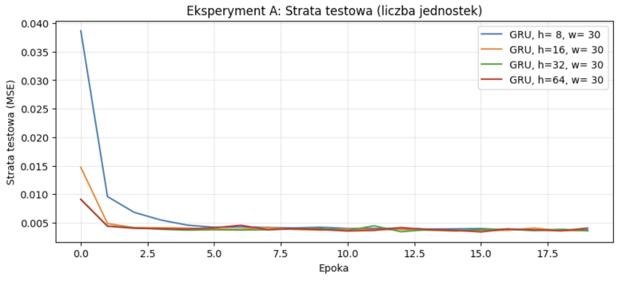
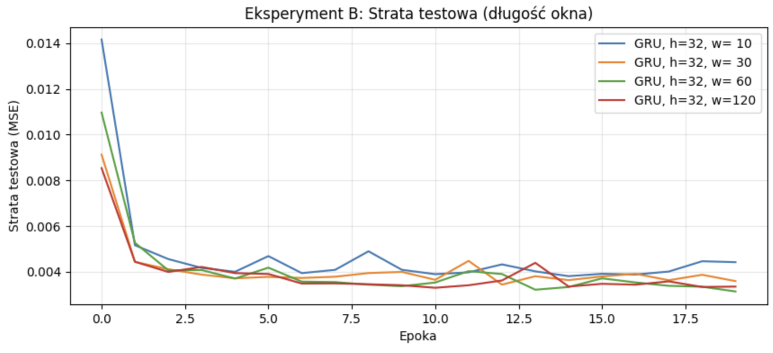
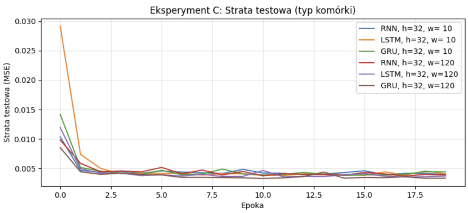
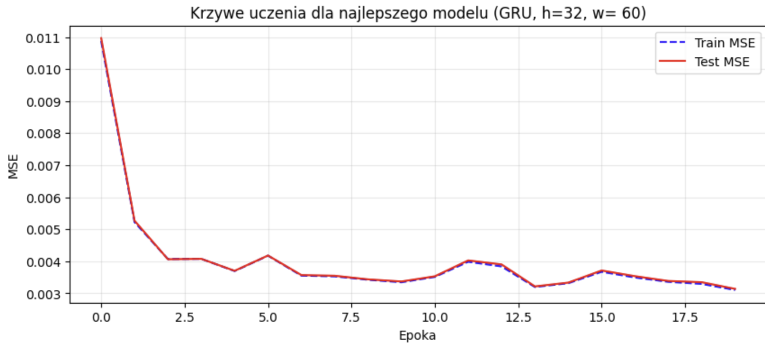
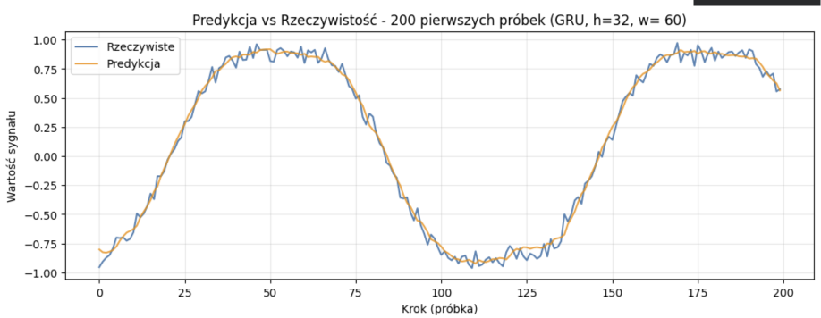

# Szablon sprawozdania laboratoryjnego

**Przedmiot:** Uczenie głębokie w systemach rozpoznawania i przetwarzania mowy
**Zajęcia nr / temat:** Sieci rekurencyjne: budowa i uczenie
**Autor / grupa:** Mateusz Pluta GL5.03
**Data:** 22.10.2026r.

## 1. Cel ćwiczenia

Celem zadania było zaimplementowanie prostego modelu sieci rekurencyjnej (RNN) w PyTorch i nauczenie go przewidywania kolejnej próbki szeregu czasowego (sygnału sinusoidalnego z szumem). Następnie, poprzez serię eksperymentów, sprawdzenie jak zmiana liczby jednostek ukrytych (hidden), długości okna czasowego oraz typu komórki (SimpleRNN, GRU, LSTM) wpływa na jakość predykcji (błąd MSE) oraz stabilność uczenia

## 2. Metoda i implementacja

**Wykorzystane narzędzia i modele:**
PyTorch

Zestaw 2000 próbek wygenerowanego sygnału będącego sumą dwóch sinusoid i szumu gaussowskiego. Dane podzielono chronologicznie na zbiór treningowy i testowy poprzez utworzenie okien przesuwnych.

**Link do repozytorium/notatnika:**
https://github.com/mattty1/Speech-Recognition.git

**Konfiguracja (parametry, dane):**

Skonstruowano model składający się z jednej warstwy rekurencyjnej oraz warstwy liniowej. Użyto optymalizatora Adam, funkcji straty MSELoss oraz paczek po 64 okna. Zastosowano odcinanie gradientu, aby zapobiec jego wybuchowi.
Ewaluacja: Każdy eksperyment uruchamiano trzykrotnie z różnymi ziarnami losowości, a jako wynik brano uśrednioną stratę testową z 5 ostatnich epok.

## 3. Wyniki

Hipotezy przed eksperymentami:
Eksperyment A: Zwiększenie liczby jednostek poprawi wynik, ale od pewnego momentu zysk będzie marginalny, a czas treningu wzrośnie.
Eksperyment B: Zbyt krótkie okno uniemożliwi rozpoznanie fazy, jednak dla bardzo długiego okna pojawi się problem zanikającego gradientu.

**Punkt odniesienia**

| Konfiguracja | Liczba parametrów | Test MSE (średnia ± odchylenie) | Czas treningu |
| :--- | :--- | :--- | :--- |
| Heurystyka "ostatnia próbka" | - | 0.00631 | - |
| Model bazowy (RNN, h=32, w=30) | 1153 | 0.00411 ± 0.00014 | 4.94s |

**Eksperyment A - Wpływ liczby jednostek**

| Konfiguracja | Liczba parametrów | Test MSE (średnia ± odchylenie) | Czas treningu |
| :--- | :--- | :--- | :--- |
| GRU, h=8 | 273 | 0.00380 ± 0.00004 | 5.79s |
| GRU, h=16 | 929 | 0.00374 ± 0.00002 | 6.25s |
| GRU, h=32 | 3393 | 0.00376 ± 0.00001 | 7.07s |
| GRU, h=64 | 12929 | 0.00375 ± 0.00008 | 11.51s |

**Eksperyment B - Długość okna**

| Konfiguracja | Liczba parametrów | Test MSE (średnia ± odchylenie) | Czas treningu |
| :--- | :--- | :--- | :--- |
| GRU, OKNO=10 | 3393 | 0.00414 ± 0.00019 | 3.17s |
| GRU, OKNO=30 | 3393 | 0.00376 ± 0.00001 | 7.12s |
| GRU, OKNO=60 | 3393 | 0.00343 ± 0.00021 | 14.31s |
| GRU, OKNO=120 | 3393 | 0.00344 ± 0.00019 | 27.35s |

**Eksperyment C - Typ komórki**

| Konfiguracja | Liczba parametrów | Test MSE (średnia ± odchylenie) | Czas treningu |
| :--- | :--- | :--- | :--- |
| RNN, OKNO=10 | 1153 | 0.00417 ± 0.00025 | 1.45s |
| LSTM, OKNO=10 | 4513 | 0.00415 ± 0.00011 | 2.69s |
| GRU, OKNO=10 | 3393 | 0.00414 ± 0.00019 | 2.79s |
| RNN, OKNO=120 | 1153 | 0.00400 ± 0.00001 | 9.97s |
| LSTM, OKNO=120 | 4513 | 0.00375 ± 0.00013 | 16.49s |
| GRU, OKNO=120 | 3393 | 0.00344 ± 0.00019 | 26.83s |

## 4. Analiza i interpretacja

**W eksperymencie A:** zauważono, że zwiększanie liczby jednostek z 8 do 32 przyniosło poprawę, jednak przy 64 jednostkach wynik przestał się znacząco polepszać, a model potrzebował więcej czasu na obliczenia z powodu drastycznego wzrostu liczby parametrów (z 273 na prawie 13 tysięcy).

**W eksperymencie B:** długość okna 30 i 60 sprawdzała się najlepiej, ponieważ pozwalała sieci "zobaczyć" odpowiedni fragment fali (okres głównej sinusoidy to ok. 126 próbek). Okno 10 to za mało kontekstu, by odczytać trend, natomiast okno 120 dla RNN powoduje niestabilność na skutek długiego łańcucha BPTT.

**W eksperymencie C:**, dla krótkiego okna (10) różnice między RNN a bramkowanymi komórkami LSTM i GRU były niewielkie. Jednak przy oknie 120 zwykły model RNN ulegał degradacji przez efekt zanikającego gradientu (odległe w czasie kroki przestawały wpływać na uczenie). LSTM i GRU dzięki bramkom z powodzeniem tworzyły ścieżki przepływu dla gradientu i utrzymywały niską stratę.

## 5. Wnioski

1. Większa liczba jednostek nie zawsze poprawia wynik. Po osiągnięciu odpowiedniej pojemności modelu (np. 32 dla tego zadania), dalsze zwiększanie zwiększa jedynie koszt obliczeniowy i grozi przeuczeniem.

2.  Najlepsze wyniki osiągano przy oknie długości ok. 30-60 próbek, co dawało wystarczający kontekst czasowy, by uchwycić fazę, unikając przy tym zjawiska zanikającego gradientu charakterystycznego dla bardzo długich sekwencji.

3.  RNN i GRU/LSTM nie reagują tak samo na wydłużenie okna. Sieci GRU i LSTM, dzięki wewnętrznym bramkom, zdecydowanie lepiej od zwykłego RNN radzą sobie z dalekimi zależnościami w czasie (np. okno 120).

4.  Wytrenowane modele (szczególnie LSTM i GRU z oknem 30) były wyraźnie lepsze od prostej heurystyki "ostatnia próbka" (test MSE rzędu ~0.0035 w stosunku do ~0.0063 heurystyki).

5.  Podczas uczenia, z uwagi na relatywnie mały zbiór testowy, można było zaobserwować poszarpania (niewielką niestabilność) krzywej straty testowej pomiędzy epokami.

Postawione hipotezy potwierdziły się – bramkowanie faktycznie chroni przed długimi oknami, a powiększanie warstw ma sens tylko do pewnego granicznego poziomu.
---

## Kryteria oceny (rubryka)

| Element | Waga |
|---|---|
| Poprawność implementacji | 40% |
| Wyniki i ich interpretacja | 30% |
| Czytelność kodu (PEP8, komentarze) | 20% |
| Wnioski | 10% |

Próg zaliczenia sprawozdań (O1): 90%. Oddanie: do tygodnia po zajęciach.

---

Prowadzący: dr Tomasz Cieplak / mgr inż. Patryk Marek, Rok akademicki: 2026/27
