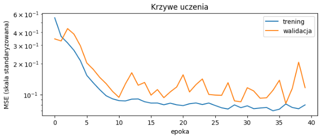
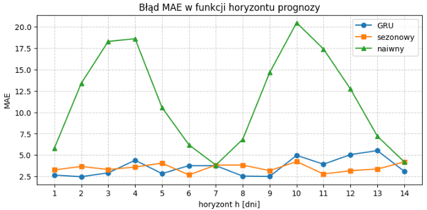

# Szablon sprawozdania laboratoryjnego

**Przedmiot:** Uczenie głębokie do rozpoznawania obiektów
**Zajęcia nr / temat:** Prognozowanie szeregów czasowych — prognoza wielokrokowa i porównanie z
baseline'ami
**Autor / grupa:** Mateusz Pluta / GL5.03
**Data:** 29.10.2026r.

## 1. Cel ćwiczenia

Sprawdzenie, czy model GRU wnosi coś ponad proste reguły w prognozie jedno- i
wielokrokowej, przy uczciwej walidacji czasowej

## 2. Metoda i implementacja

Dane: Skorzystanie ze sztucznie wygenerowanego szeregu czasowego (1000 dni), który posiadał rosnący trend, sezonowość tygodniową i roczną oraz nieprzewidywalny, losowy szum. Zbiór podzieliliśmy zachowując chronologię (trening: 70%, walidacja: 15%, test: 15%) – nie mieszaliśmy dni losowo, aby model nie podglądał "przyszłości".   

Standaryzacja:Parametry do przeskalowania danych (średnią i odchylenie) wyliczenie wyłącznie ze zbioru treningowego. Uchroniło to przed tzw. przeciekiem danych.

Model: Zastosowanie jednokierunkową sieć GRU (32 jednostki ukryte), paczki (batch) po 64 okna oraz optymalizator Adam. Zastosowano metodę "early stopping" – po wyznaczonej liczbie epok przywracóno wagi z tej, w której błąd na zbiorze walidacyjnym był najniższy.

Link do repozytorium: https://github.com/mattty1/Speech-Recognition.git

## 3. Wyniki
1.

Najlepsza epoka: 22
Na wykresie widać przeuczenie. Zbiór treningowy po około 25-30 epokach utrzymuje się na niskim poziomie a błąd na zbiorze walidacyjnym przestaje spadać i zaczyna rosnąć.

2.

| Metoda | MAE 1-krok | RMSE 1-krok | MAE wielo | RMSE wielo |
| :--- | :--- | :--- | :--- | :--- |
| GRU | 2.65 | 3.15 | 3.60 | 4.45 |
| sezonowy | 3.25 | 3.93 | 3.51 | 4.28 |
| naiwny | 5.79 | 7.36 | 11.44 | 13.29 |

3.

| okno | ziarno | val MSE | MAE 1-krok | MAE 14-krok |
| :--- | :--- | :--- | :--- | :--- |
| 3 | 0 | 0.2995 | 5.12 | 8.21 |
| 3 | 1 | 0.2863 | 4.94 | 8.42 |
| 7 | 0 | 0.0947 | 3.07 | 4.99 |
| 7 | 1 | 0.0897 | 3.10 | 5.02 |
| 28 | 0 | 0.0923 | 2.60 | 3.60 |
| 28 | 1 | 0.0878 | 2.82 | 4.18 |

Najlepsze okno według walidacji: 28

## 4. Analiza i interpretacja

GRU vs baseline'y w prognozie jedno- i wielokrokowej: Model GRU wyraźnie pokonuje reguły bazowe w prognozie jednokrokowej (np. MAE na poziomie 2,60–2,65 względem 3,25 dla reguły sezonowej). W prognozie wielokrokowej (H=14) wynik GRU jest jednak zbliżony do prostego powielenia ostatniego tygodnia, a czasem nawet minimalnie gorszy. Wynika to z faktu, że GRU prognozuje wariant rekurencyjny krok po kroku, przez co błędy z pierwszych dni kumulują się i obciążają predykcje w dalszych dniach horyzontu.

Dystans do granicy szumu (2,39): Wynik modelu GRU w prognozie jednokrokowej (najlepiej ok. 2,60 dla okna 28) jest bardzo blisko teoretycznej granicy błędu wynoszącej 2,39. Oznacza to, że model niemal perfekcyjnie wyodrębnił sygnał (trend i sezonowość), a to, co zostało do przewidzenia, to w przeważającej mierze nieprzewidywalny szum.

Wpływ długości okna: Okno 3-dniowe daje najgorsze wyniki, ponieważ jest zbyt krótkie, aby model mógł zauważyć kluczową dla tych danych sezonowość tygodniową (7 dni). Wydłużenie okna do 7, a zwłaszcza 28 dni, pozwala sieci uchwycić pełne cykle i zależności okresowe, co drastycznie zmniejsza błąd predykcji.

Różnice między wariantami a ziarnami: Różnice pomiędzy poszczególnymi wariantami długości okna są zdecydowanie większe niż rozrzut błędów wynikający ze zmiany ziarna losowości. Zmiana okna z 3 na 7 dni redukuje stratę walidacyjną o około 0,2, podczas gdy różnice między ziarnami w ramach tego samego okna to zaledwie ułamki rzędu 0,01.

Przełożenie na modele mowy: Wnioski te bezpośrednio odnoszą się do modelowania sygnału mowy krok po kroku (np. autoregresyjna synteza mowy, TTS). Odpowiednio długie okno kontekstu jest niezbędne do modelowania zależności fonetycznych i prozodii – zbyt krótkie nie uchwyci struktury dźwięku. Ponadto zjawisko kumulacji błędów z prognozy wielokrokowej powoduje, że wygenerowany sygnał mowy może z czasem tracić na jakości, stając się zniekształcony lub nienaturalny.

## 5. Wnioski

Długość historii wejściowej musi obejmować pełne cykle sezonowe (7 lub 28 dni). Zbyt krótkie okno (3 dni) uniemożliwia uchwycenie wzorców.
W prognozie 1-krokowej GRU niemal osiąga barierę szumu (~2,39). Jednak w rekurencyjnej prognozie wielokrokowej błędy narastają, niwelując przewagę modelu nad prostym baseline'em sezonowym.
Wykresy strat jasno pokazują, że zbyt długi trening (powyżej 25-30 epok) prowadzi do zapamiętywania szumu w danych i spadku generalizacji.

---

## Kryteria oceny (rubryka)

| Element | Waga |
|---|---|
| Poprawność implementacji | 40% |
| Wyniki i ich interpretacja | 30% |
| Czytelność kodu (PEP8, komentarze) | 20% |
| Wnioski | 10% |

Próg zaliczenia sprawozdań (O1): 90%. Oddanie: do tygodnia po zajęciach.
