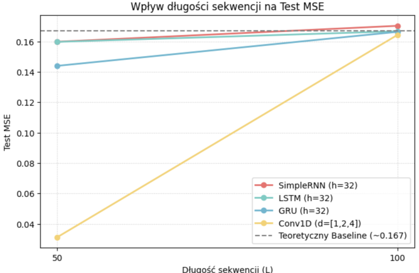

# Szablon sprawozdania laboratoryjnego

**Przedmiot:** Uczenie głębokie w systemach rozpoznawania i przetwarzania mowy
**Zajęcia nr / temat:** 4 / Obsługa długich sekwencji z użyciem SimpleRNN, LSTM, GRU i Conv1D
**Autor / grupa:** Mateusz Pluta / GL 5.03
**Data:** 05.11.2026r.

## 1. Cel ćwiczenia

Porównanie czterech architektur w zadaniu sumowania wartości wskazywanych z opóźnieniem.
Sprawdzenie, jak na jakość predykcji wpływają długość sekwencji, rozmiar stanu ukrytego i pole recepcyjne splotu.

## 2. Metoda i implementacja

**Rozmiar zbioru treningowego / testowego:** 4000 / 800
**Hiperparametry:** 30 epok, batch size = 128, learning rate = 5e-3

**Link do repozytorium/notatnika:**https://github.com/mattty1/Speech-Recognition.git

## 3. Wyniki

| Model | Test MSE (L=50) | Czas (L=50) | Test MSE (L=100) | Czas (L=100) | Params |
|---|---|---|---|---|---|
| **Baseline (Predykcja stała)** | 0.1598 | - | 0.1667 | - | 0 |
| **SimpleRNN (h=32)** | 0.1598 | 7.9s | 0.1703 | 14.8s | 1 185 |
| **LSTM (h=32)** | 0.1597 | 17.6s | 0.1667 | 31.8s | 4 641 |
| **GRU (h=32)** | 0.1439 | 26.4s | 0.1663 | 40.8s | 3 489 |
| **Conv1D (d=[1,2,4])** | 0.0312 | 34.9s | 0.1643 | 62.1s | 25 217 |
| **SimpleRNN (h=64)** | - | - | 0.1673 | 22.0s | 4 417 |
| **Conv1D (d=[1,1,1])** | - | - | 0.1641 | 55.4s | 25 217 |

## 4. Analiza i interpretacja

- **Krótka sekwencja (L=50):** Przewidywanie modelu odniesienia (stałej średniej) dało błąd na poziomie 0.1598. Model Conv1D z dylatacją [1,2,4] jako jedyny odniósł wyraźny sukces, radykalnie redukując błąd do 0.0312. Minimalną poprawę wykazał model GRU (0.1439), natomiast LSTM i SimpleRNN pozostały na poziomie predykcji stałej (0.1597 - 0.1598).
- **Długa sekwencja (L=100):** Błąd predykcji bazowej wynosił 0.1667. W tych warunkach treningowych (30 epok) żaden z modeli nie potrafił skutecznie zminimalizować błędu MSE – wszystkie architektury zatrzymały się w przedziale 0.164 – 0.170, co oznacza regresję do średniej. Modele nie zdołały nauczyć się tak długoterminowej zależności we wskazanym czasie.

**Modyfikacje parametrów L=100**
- Zwiększenie stanu ukrytego w SimpleRNN (z h=32 na h=64) powiększyło liczbę parametrów (z 1 185 do 4 417), ale nie poprawiło predykcji (MSE 0.1673). Potwierdza to, że przyczyna leży w architekturze, a nie pojemności sieci.
- Zmiana dylatacji Conv1D na [1,1,1] zmniejszyła jego pole recepcyjne. Choć w teorii utrudnia to lokalne wychwycenie powiązań, błąd (0.1641) pozostał niemal identyczny jak dla wariantu rozszerzonego (0.1643), co sugeruje, że przy tak długim ciągu dla 30 epok żaden wariant Conv1D nie zdołał wyciągnąć wzorca.

**Analiza przykładu z dużym błędem (SimpleRNN, L=100):**

Pozycje znaczników: 9, 65
Pozycje wartości (t-8): 1, 57
Prawdziwa suma: 1.9609 
Predykcja modelu: 0.9421
Wniosek: Znaczniki pojawiły się bardzo daleko od siebie oraz daleko od końca sekwencji. Prawdziwa suma wynosiła ~1.96, a model wskazał 0.9421 (wartość bardzo bliską średniej ze zbioru, która wynosiła 0.994). Sieć, ze względu na problem zanikającego gradientu oraz "wypłukiwania pamięci" komórki na przestrzeni 100 kroków, "zapomniała" o historycznych wartościach i dokonała po prostu bezpiecznej predykcji średniej ze wszystkich danych. 

## 5. Wnioski

Zadanie sumowania z opóźnieniem udowadnia słabość prostych sieci rekurencyjnych (SimpleRNN) w modelowaniu informacji oddalonych w czasie. Zjawisko zanikającego gradientu uniemożliwia transfer wiedzy z początku do końca tak dużej sekwencji.

Model z rozszerzonym splotem 1D (Conv1D) radził sobie najlepiej na krótszym dystansie (L=50), łącząc oddalone cechy za pomocą dylatacji.

Gorsze od oczekiwanych wyniki modeli bramkowanych (LSTM, GRU) przy L=100 (brak pokonania baseline'u) w eksperymencie wskazują, że 30 epok treningowych dla tak skomplikowanego zadania i takich hiperparametrów jest niewystarczające.

Kierunki poprawy: Aby zmusić LSTM lub GRU do nauczenia się dystansu L=100, należałoby znacząco wydłużyć czas treningu (np. do 100-200 epok), obniżyć learning rate przy końcu treningu (schedulery) oraz upewnić się, że gradient nie ulega zbytniemu nasyceniu.

---

## Kryteria oceny (rubryka)

| Element | Waga |
|---|---|
| Poprawność implementacji | 40% |
| Wyniki i ich interpretacja | 30% |
| Czytelność kodu (PEP8, komentarze) | 20% |
| Wnioski | 10% |

Próg zaliczenia sprawozdań (O1): 90%. Oddanie: do tygodnia po zajęciach.

---

Prowadzący: dr Tomasz Cieplak / mgr inż. Patryk Marek, Rok akademicki: 2026/27
